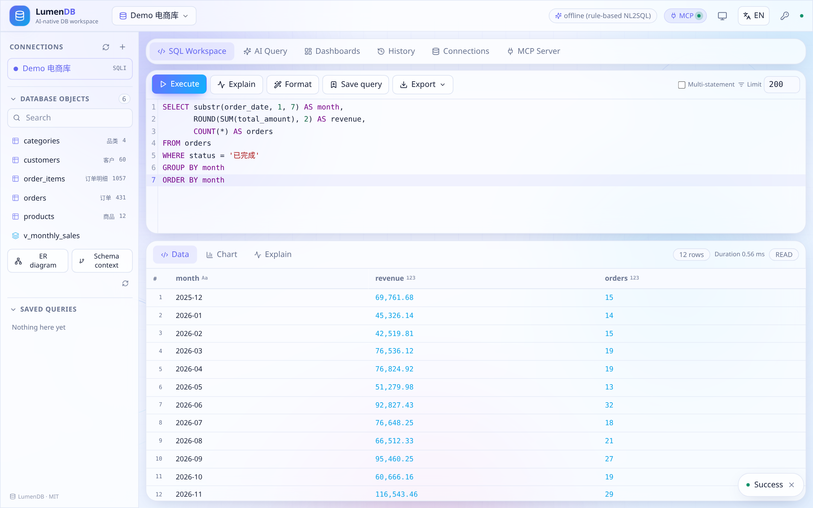
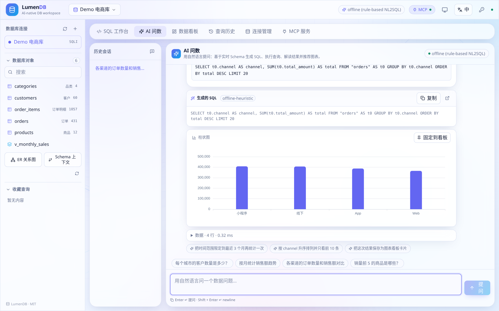
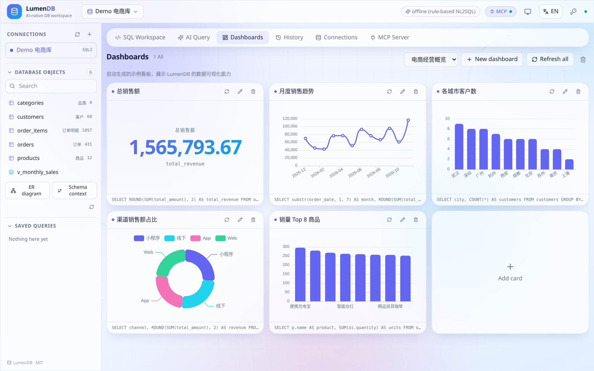
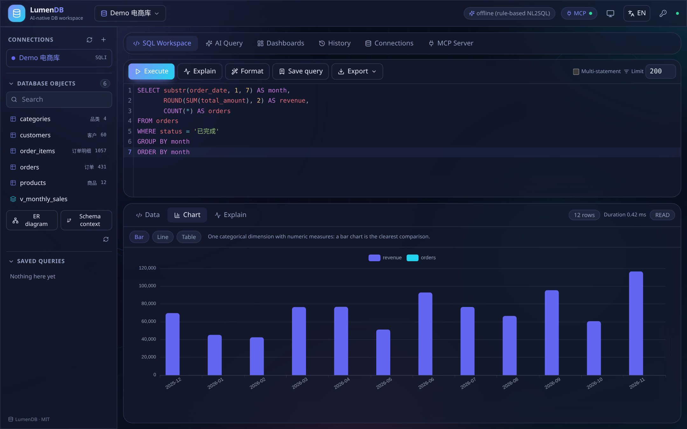
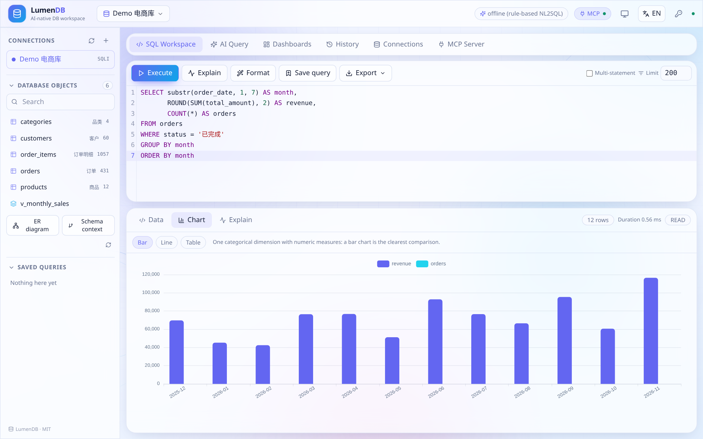
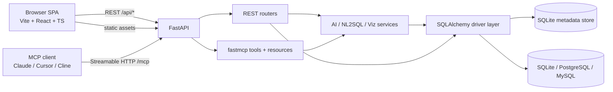

# LumenDB

**AI-native database workspace.** A front/back-separated web reimagining of [Tabularis](https://github.com/debba/tabularis), extended with AI text-to-SQL, live visualization dashboards and an HTTP MCP service.



## Overview

LumenDB is a self-hosted database workbench: everything a traditional DB admin tool does (browse schemas, write and run SQL, inspect plans, export data), plus natural-language querying, automatic charting, dashboards, and a Model Context Protocol server that lets any MCP-capable AI agent query your databases safely.

It is a **B/S architecture**: a FastAPI backend (REST + MCP + static hosting on one port) and a Vite/React SPA. It boots with a seeded demo e-commerce database, so you can try every feature immediately — no API key, no external service, no configuration.

## Compared with Tabularis

| Capability | Tabularis (Tauri desktop) | LumenDB |
| --- | --- | --- |
| Delivery | Tauri + Rust desktop app | B/S: FastAPI + React SPA, single-port HTTP |
| Databases | Multiple drivers | SQLAlchemy unified layer: SQLite / PostgreSQL / MySQL |
| SQL IDE | Monaco editor, data grid | CodeMirror 6 with schema-aware completion, EXPLAIN, saved queries, CSV/JSON/SQL export, query history |
| Schema browsing | Table browser | Tables + views, column/PK/FK/index/DDL/sample introspection, ER diagram, schema-context digest |
| AI | Text-to-SQL via schema prompt (requires an LLM) | **Offline rule-based NL2SQL works with no key**; optional OpenAI-compatible LLM; multi-turn sessions, SQL explain/fix, natural-language answers |
| Visualization | Visual query builder, visualized EXPLAIN | Auto chart recommendation (bar/line/area/pie/scatter/metric/table) + dashboards with live SQL-backed cards, pin charts from AI |
| MCP | stdio, 5 tools | **Streamable HTTP on the same port**, 10 tools + 2 resources, JSON/TOON/CSV output |
| Access | Local, single user | HTTP API, token auth, deploy behind a tunnel, browser-based i18n/theme |
| UX | Desktop | `en` (default) / `zh`, system / light / dark theme, animated light background, mobile-first responsive, inline SVG icons (no emoji) |

## Features

- **Connections** — create/test/edit connections; list databases, schemas, tables and views; describe a table (columns, primary/foreign keys, indexes, DDL, sample rows); preview data; ER diagram.
- **SQL workbench** — CodeMirror 6 with live schema completion, `Ctrl/⌘+Enter` to run, multi-statement execution, format, save, EXPLAIN plan, export, history, and an explicit confirmation dialog for writes.
- **AI Query (AI 问数)** — ask a question in Chinese or English; LumenDB assembles schema context, generates SQL, executes it, explains the answer and recommends a chart. Multi-turn sessions, suggested follow-ups, SQL explanation and repair, one-click "pin to dashboard".
- **Visualization** — charts are recommended from the result shape; dashboards are grids of cards backed by live SQL queries with refresh-all.
- **MCP server** — 10 tools and 2 resources over Streamable HTTP at `/mcp`, strict read-only enforcement, compact TOON output for token efficiency, ready-to-copy client config snippets.
- **Platform** — single-port deployment (UI + REST + MCP), optional shared-secret auth, CORS, row limits and statement timeouts, encrypted stored passwords, MIT licensed.
- **Polished UX** — Esc / outside-click closes dialogs, saved queries refresh instantly, the Explain tab builds a plan on demand, chart labels are localized, AI follow-ups are clickable, double-click a result cell to copy it, theme switching always gives visible feedback, and the layout has no horizontal overflow at 390 / 768 / 1440 px.

## More screenshots

| AI Query (text-to-SQL) | Dashboards | Dark theme |
| --- | --- | --- |
|  |  |  |

Additional captures (charts, MCP page, connections, Chinese UI) are in [docs/screenshots](docs/screenshots).



## Quick start

Prerequisites: Python 3.11+, [uv](https://docs.astral.sh/uv/), Node 20+, pnpm.

```bash
git clone https://github.com/liudonghua123/LumenDB.git
cd LumenDB

# one command: install deps, build the SPA and serve everything on :8000
bash scripts/start.sh

# or two processes with hot reload (UI :5173, API :8000)
bash scripts/dev.sh
```

Then open:

| URL | What |
| --- | --- |
| `http://localhost:8000/` | Web UI (after `pnpm build`) |
| `http://localhost:5173/` | Web UI in dev mode |
| `http://localhost:8000/docs` | OpenAPI docs |
| `http://localhost:8000/mcp` | MCP Streamable HTTP endpoint |

On first boot the backend creates `backend/data/demo.sqlite` (5 tables + 1 view: customers, products, orders, order_items, categories, ~1.5k rows), a demo connection and a sample dashboard. Nothing else is required.

Manual start:

```bash
cd backend && uv sync && uv run uvicorn app.main:app --reload --port 8000
cd frontend && pnpm install && pnpm dev      # separate terminal
```

## Architecture



A single `uvicorn` process owns the lifespan that bootstraps storage and the MCP session manager. Details: [docs/ARCHITECTURE.md](docs/ARCHITECTURE.md) · [中文](docs/ARCHITECTURE.zh-CN.md).

## Configuration

All settings are optional environment variables with the `LUMEN_` prefix; copy [backend/.env.example](backend/.env.example) to `backend/.env` to edit.

| Variable | Default | Purpose |
| --- | --- | --- |
| `LUMEN_HOST` / `LUMEN_PORT` | `0.0.0.0` / `8000` | Bind address |
| `LUMEN_API_TOKEN` | empty | Shared secret for `/api/*` and `/mcp` (`X-API-Token` or `Authorization: Bearer`) |
| `LUMEN_ALLOW_WRITE` | `true` | Allow writes via REST (still requires `confirm_write=true`); MCP stays read-only |
| `LUMEN_MAX_ROWS` / `LUMEN_MCP_MAX_ROWS` | `1000` / `100` | Row caps |
| `LUMEN_QUERY_TIMEOUT` | `30` | Statement timeout (seconds) |
| `LUMEN_MCP_PATH` | `/mcp` | MCP endpoint path |
| `LUMEN_LLM_BASE_URL` / `LUMEN_LLM_API_KEY` / `LUMEN_LLM_MODEL` | empty | Any OpenAI-compatible endpoint; leave empty for the offline engine |
| `LUMEN_SECRET` | dev secret | Encrypts saved connection passwords |

## AI Query: offline by default

With no LLM configured, LumenDB uses a deterministic, rule-based NL2SQL engine built on the live schema:

1. Assemble a compact schema digest (tables, labelled columns, types, FK graph, sample rows).
2. Parse intent from the question: metric, dimension, grouping, time range, Top-N, filters (Chinese and English).
3. Score schema objects, resolve the main table and JOIN path through the foreign-key graph.
4. Build dialect-aware SQL, execute it read-only, then generate an answer and recommend charts.

It handles questions such as `按月统计销售额趋势`, `销量前 5 的商品是哪些？`, `各渠道的订单数量和销售额对比`, `小程序渠道的订单数`. For open-ended questions, configure any OpenAI-compatible endpoint (OpenAI, DeepSeek, Ollama, vLLM) and the same pipeline switches to LLM-generated SQL with automatic fallback to the offline engine.

## MCP

```json
{
  "mcpServers": {
    "lumendb": {
      "url": "http://localhost:8000/mcp",
      "headers": { "X-API-Token": "<your LUMEN_API_TOKEN>" }
    }
  }
}
```

Tools: `list_connections`, `list_databases`, `list_tables`, `describe_table`, `run_query`, `ask_data`, `recommend_chart`, `explain_query`, `get_schema_context`, `list_dashboards`. Resources: `lumendb://connections`, `lumendb://{connection_id}/schema`.

Expose it publicly with your own domain, for example `cloudflared tunnel --url http://localhost:8000` or an existing named tunnel with an ingress rule pointing to `localhost:8000`.

Full protocol examples, output formats and client snippets: [docs/MCP.md](docs/MCP.md) · [中文](docs/MCP.zh-CN.md).

## Project layout

```
LumenDB/
├── backend/            FastAPI + fastmcp (uv, pyproject.toml, uv.lock)
│   ├── app/
│   │   ├── db/         SQLAlchemy drivers, SQL classification, EXPLAIN, ER graph
│   │   ├── services/   NL2SQL, LLM adapter, visualization, AI orchestration
│   │   ├── routers/    REST routes
│   │   ├── store.py    metadata store
│   │   ├── mcp_server.py
│   │   └── main.py     app assembly + SPA hosting
│   ├── tests/          pytest smoke tests
│   └── data/           demo + metadata SQLite (gitignored)
├── frontend/           Vite + React + TS (pnpm)
│   └── src/components|lib|i18n|styles
├── docs/               architecture, MCP guide, screenshots
├── scripts/            start.sh (single port), dev.sh (hot reload)
├── LICENSE             MIT
└── README.md / README.zh-CN.md
```

## Documentation

| Document | English | 中文 |
| --- | --- | --- |
| Root overview | [README.md](README.md) | [README.zh-CN.md](README.zh-CN.md) |
| Backend | [backend/README.md](backend/README.md) | [backend/README.zh-CN.md](backend/README.zh-CN.md) |
| Frontend | [frontend/README.md](frontend/README.md) | [frontend/README.zh-CN.md](frontend/README.zh-CN.md) |
| Architecture | [docs/ARCHITECTURE.md](docs/ARCHITECTURE.md) | [docs/ARCHITECTURE.zh-CN.md](docs/ARCHITECTURE.zh-CN.md) |
| Source repository | [GitHub: liudonghua123/LumenDB](https://github.com/liudonghua123/LumenDB) | [Issues](https://github.com/liudonghua123/LumenDB/issues) |
| MCP guide | [docs/MCP.md](docs/MCP.md) | [docs/MCP.zh-CN.md](docs/MCP.zh-CN.md) |

## Verification

```bash
cd backend && uv sync --extra dev && uv run pytest -q   # 7 smoke tests: REST, AI, safety, MCP
cd frontend && pnpm typecheck && pnpm build
```

## License

[MIT](LICENSE)
