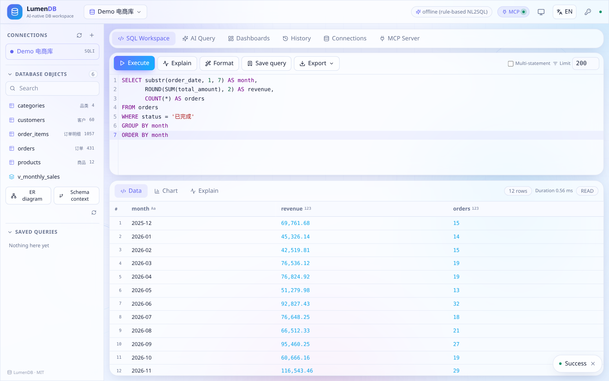
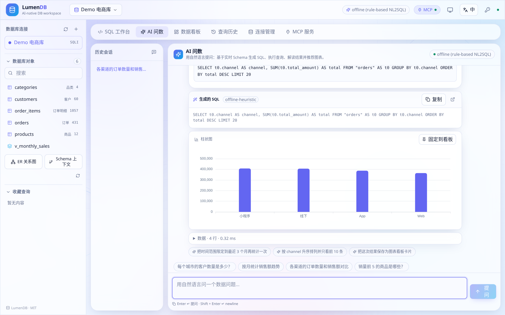
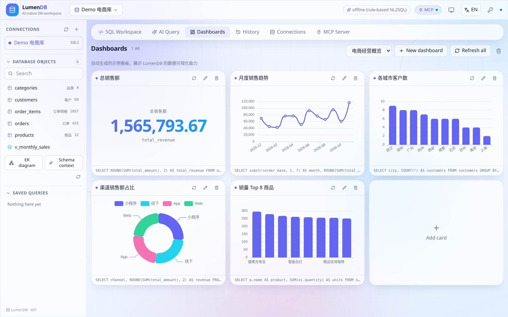
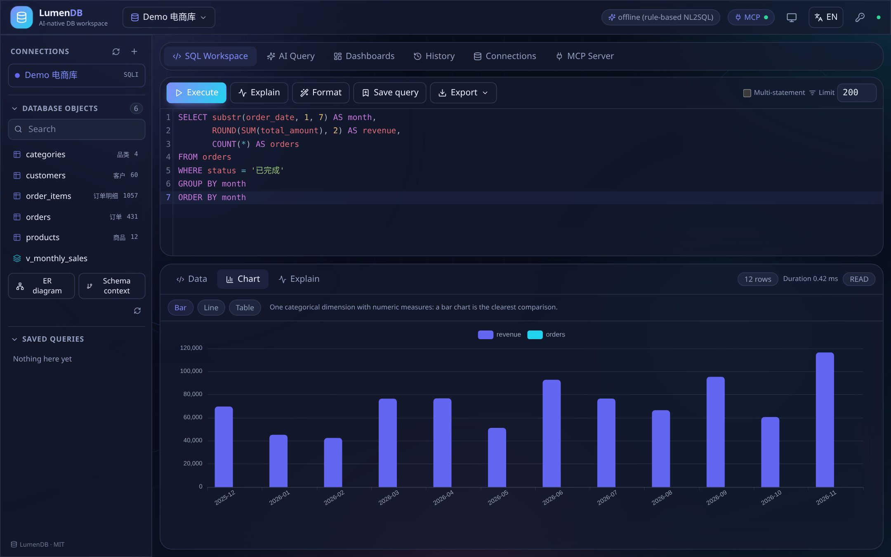
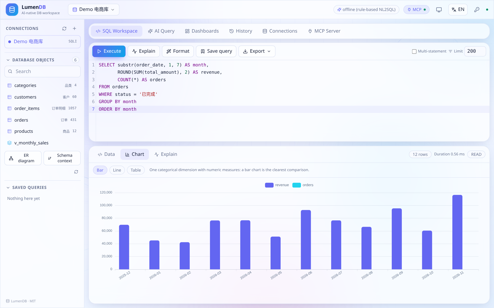
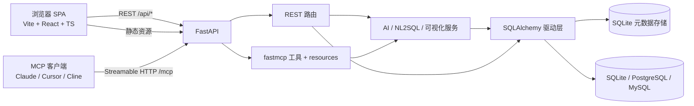

# LumenDB

**AI 原生数据库工作台。** 参考 [Tabularis](https://github.com/debba/tabularis) 并实现前后端分离的 Web 化重构，扩展了 AI 问数、实时数据可视化看板与 HTTP MCP 对外服务。



## 项目简介

LumenDB 是一套可自托管的数据库工作台：既覆盖传统数据库管理工具的全部能力（浏览 Schema、编写执行 SQL、查看执行计划、导出数据），又提供自然语言问数、自动图表推荐、可视化看板，以及让任意支持 MCP 的 AI Agent 安全查询数据库的 MCP 服务。

采用 **B/S 架构**：FastAPI 后端（同端口提供 REST + MCP + 静态托管）与 Vite/React 前端 SPA。启动时自动播种一套电商演示库，所有功能开箱即用 —— 无需 API Key、无需外部服务、无需配置。

## 与 Tabularis 的对比

| 能力 | Tabularis（Tauri 桌面端） | LumenDB |
| --- | --- | --- |
| 交付形态 | Tauri + Rust 桌面应用 | B/S：FastAPI + React SPA，单端口 HTTP |
| 数据库 | 多驱动 | SQLAlchemy 统一驱动层：SQLite / PostgreSQL / MySQL |
| SQL IDE | Monaco 编辑器、数据网格 | CodeMirror 6（Schema 感知补全）、EXPLAIN、收藏查询、CSV/JSON/SQL 导出、查询历史 |
| Schema 浏览 | 表浏览器 | 表 + 视图、列/主键/外键/索引/DDL/样例数据探查、ER 关系图、Schema 上下文摘要 |
| AI | 基于 Schema 提示词的 Text-to-SQL（需 LLM） | **内置离线规则版 NL2SQL，无需 Key**；可选接入 OpenAI 兼容 LLM；多轮会话、SQL 解释/修复、自然语言结论 |
| 可视化 | 可视化查询构建器、EXPLAIN 可视化 | 按结果形状自动推荐图表（柱/线/面积/饼/散点/指标/表格）+ 由实时 SQL 卡片组成的看板，AI 结果可一键固定 |
| MCP | stdio，5 个工具 | **同端口 Streamable HTTP**，10 个工具 + 2 个 resources，支持 JSON/TOON/CSV 输出 |
| 访问方式 | 本地单用户 | HTTP API、令牌鉴权、可经内网穿透对外、浏览器端 i18n / 主题 |
| 体验 | 桌面端 | 默认英文 / 可切中文、跟随系统 / 浅色 / 深色主题、动态浅色背景、移动优先响应式、内联 SVG 图标（不使用 emoji） |

## 功能清单

- **连接管理** —— 新建/测试/编辑连接；列出数据库、Schema、表与视图；表详情（列、主外键、索引、DDL、样例行）；数据预览；ER 关系图。
- **SQL 工作台** —— CodeMirror 6 + 实时 Schema 补全，`Ctrl/⌘+Enter` 执行，多语句执行，格式化，收藏，EXPLAIN 计划，导出，历史记录，写操作显式二次确认。
- **AI 问数** —— 中英文自然语言提问；自动组装 Schema 上下文 → 生成 SQL → 执行 → 解读结果 → 推荐图表。支持多轮会话、推荐追问、SQL 解释与修复、一键「固定到看板」。
- **数据可视化** —— 依据结果形状推荐图表；看板由实时 SQL 查询驱动的卡片组成，支持一键刷新全部。
- **MCP 服务** —— `/mcp` 上提供 10 个工具与 2 个 resources（Streamable HTTP），强制只读，紧凑 TOON 输出节省 token，页面内可复制客户端配置。
- **平台能力** —— 单端口部署（UI + REST + MCP）、可选共享密钥鉴权、CORS、行数上限与语句超时、连接密码加密存储、MIT 协议。
- **交互细节** —— Esc / 点击外部关闭弹窗、收藏查询即时刷新、执行计划标签页按需自动生成、图表类型本地化、AI 追问可直接点击、双击结果单元格复制、主题切换始终有可见反馈，390 / 768 / 1440 px 断点均无横向溢出。

## 更多截图

| AI 问数 | 数据看板 | 深色主题 |
| --- | --- | --- |
|  |  |  |

其余截图（自动图表、MCP 页、连接管理、中文界面）见 [docs/screenshots](docs/screenshots)。



## 快速开始

环境要求：Python 3.11+、[uv](https://docs.astral.sh/uv/)、Node 20+、pnpm。

```bash
git clone https://github.com/liudonghua123/LumenDB.git
cd LumenDB

# 一条命令：安装依赖、构建 SPA、在 :8000 上提供全部服务
bash scripts/start.sh

# 或双进程热更新（UI :5173，API :8000）
bash scripts/dev.sh
```

访问地址：

| 地址 | 说明 |
| --- | --- |
| `http://localhost:8000/` | Web UI（执行 `pnpm build` 后） |
| `http://localhost:5173/` | 开发模式 Web UI |
| `http://localhost:8000/docs` | OpenAPI 文档 |
| `http://localhost:8000/mcp` | MCP Streamable HTTP 端点 |

首次启动会自动创建 `backend/data/demo.sqlite`（5 张表 + 1 个视图：customers、products、orders、order_items、categories，约 1.5k 行）、演示连接与示例看板，无需其他配置。

手动启动：

```bash
cd backend && uv sync && uv run uvicorn app.main:app --reload --port 8000
cd frontend && pnpm install && pnpm dev      # 另开一个终端
```

## 架构



单个 `uvicorn` 进程的 lifespan 同时负责存储引导与 MCP 会话管理。详见 [docs/ARCHITECTURE.zh-CN.md](docs/ARCHITECTURE.zh-CN.md) · [English](docs/ARCHITECTURE.md)。

## 配置

所有配置都是可选环境变量，前缀 `LUMEN_`；复制 [backend/.env.example](backend/.env.example) 为 `backend/.env` 后修改。

| 变量 | 默认值 | 作用 |
| --- | --- | --- |
| `LUMEN_HOST` / `LUMEN_PORT` | `0.0.0.0` / `8000` | 监听地址 |
| `LUMEN_API_TOKEN` | 空 | `/api/*` 与 `/mcp` 的共享密钥（`X-API-Token` 或 `Authorization: Bearer`） |
| `LUMEN_ALLOW_WRITE` | `true` | 允许 REST 写操作（仍需 `confirm_write=true`）；MCP 始终只读 |
| `LUMEN_MAX_ROWS` / `LUMEN_MCP_MAX_ROWS` | `1000` / `100` | 行数上限 |
| `LUMEN_QUERY_TIMEOUT` | `30` | 语句超时（秒） |
| `LUMEN_MCP_PATH` | `/mcp` | MCP 端点路径 |
| `LUMEN_LLM_BASE_URL` / `LUMEN_LLM_API_KEY` / `LUMEN_LLM_MODEL` | 空 | 任意 OpenAI 兼容端点；留空使用离线引擎 |
| `LUMEN_SECRET` | 开发密钥 | 加密保存的连接密码 |

## AI 问数：默认离线可用

未配置 LLM 时，LumenDB 使用基于实时 Schema 的确定性规则版 NL2SQL 引擎：

1. 组装紧凑 Schema 摘要（表、带业务标签的列、类型、外键图谱、样例行）。
2. 从问题中解析意图：指标、维度、分组、时间范围、Top-N、过滤条件（支持中英文）。
3. 对 Schema 对象打分，确定主表，并沿外键图谱解析 JOIN 路径。
4. 生成方言适配的 SQL，只读执行，再生成结论并推荐图表。

可处理 `按月统计销售额趋势`、`销量前 5 的商品是哪些？`、`各渠道的订单数量和销售额对比`、`小程序渠道的订单数` 等问题。面对更开放的问题，只需配置任意 OpenAI 兼容端点（OpenAI、DeepSeek、Ollama、vLLM），同一链路会切换为 LLM 生成 SQL，并自动降级回离线引擎。

## MCP 对外服务

```json
{
  "mcpServers": {
    "lumendb": {
      "url": "http://localhost:8000/mcp",
      "headers": { "X-API-Token": "<你的 LUMEN_API_TOKEN>" }
    }
  }
}
```

工具：`list_connections`、`list_databases`、`list_tables`、`describe_table`、`run_query`、`ask_data`、`recommend_chart`、`explain_query`、`get_schema_context`、`list_dashboards`。Resources：`lumendb://connections`、`lumendb://{connection_id}/schema`。

如需公网访问，可用自定义域名隧道，例如 `cloudflared tunnel --url http://localhost:8000`，或在已命名的隧道中加一条指向 `localhost:8000` 的 ingress 规则。

完整协议示例、输出格式与各客户端配置：[docs/MCP.zh-CN.md](docs/MCP.zh-CN.md) · [English](docs/MCP.md)。

## 目录结构

```
LumenDB/
├── backend/            FastAPI + fastmcp（uv、pyproject.toml、uv.lock）
│   ├── app/
│   │   ├── db/         SQLAlchemy 驱动、SQL 分类、EXPLAIN、ER 图谱
│   │   ├── services/   NL2SQL、LLM 适配器、可视化、AI 编排
│   │   ├── routers/    REST 路由
│   │   ├── store.py    元数据存储
│   │   ├── mcp_server.py
│   │   └── main.py     应用装配 + SPA 托管
│   ├── tests/          pytest 冒烟测试
│   └── data/           演示库与元数据库（已 gitignore）
├── frontend/           Vite + React + TS（pnpm）
│   └── src/components|lib|i18n|styles
├── docs/               架构、MCP 指南、截图
├── scripts/            start.sh（单端口）、dev.sh（热更新）
├── LICENSE             MIT
└── README.md / README.zh-CN.md
```

## 文档索引

| 文档 | English | 中文 |
| --- | --- | --- |
| 总览 | [README.md](README.md) | [README.zh-CN.md](README.zh-CN.md) |
| 后端 | [backend/README.md](backend/README.md) | [backend/README.zh-CN.md](backend/README.zh-CN.md) |
| 前端 | [frontend/README.md](frontend/README.md) | [frontend/README.zh-CN.md](frontend/README.zh-CN.md) |
| 架构 | [docs/ARCHITECTURE.md](docs/ARCHITECTURE.md) | [docs/ARCHITECTURE.zh-CN.md](docs/ARCHITECTURE.zh-CN.md) |
| 源码仓库 | [GitHub: liudonghua123/LumenDB](https://github.com/liudonghua123/LumenDB) | [Issues](https://github.com/liudonghua123/LumenDB/issues) |
| MCP 指南 | [docs/MCP.md](docs/MCP.md) | [docs/MCP.zh-CN.md](docs/MCP.zh-CN.md) |

## 验证

```bash
cd backend && uv sync --extra dev && uv run pytest -q   # 7 个冒烟测试：REST、AI、安全、MCP
cd frontend && pnpm typecheck && pnpm build
```

## 协议

[MIT](LICENSE)
