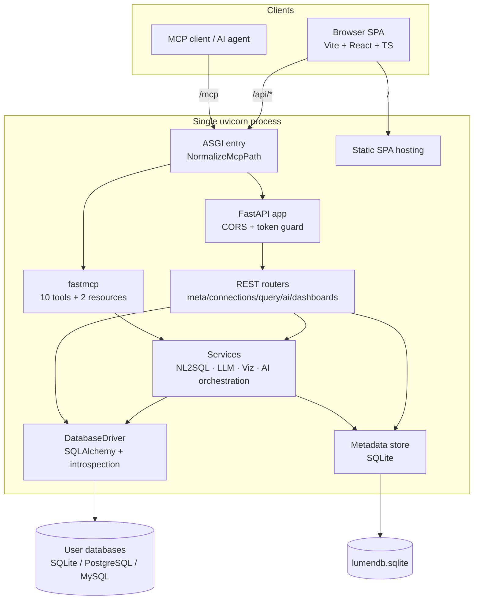
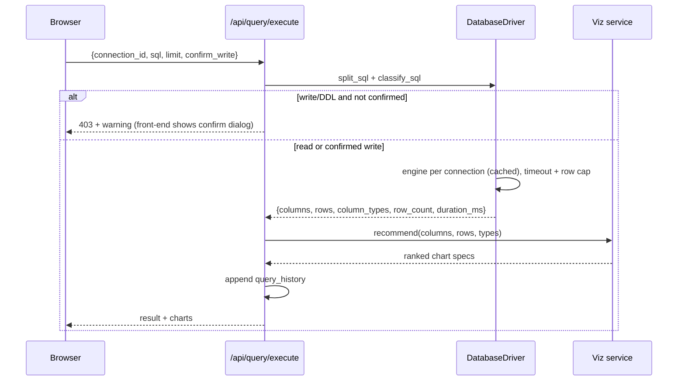
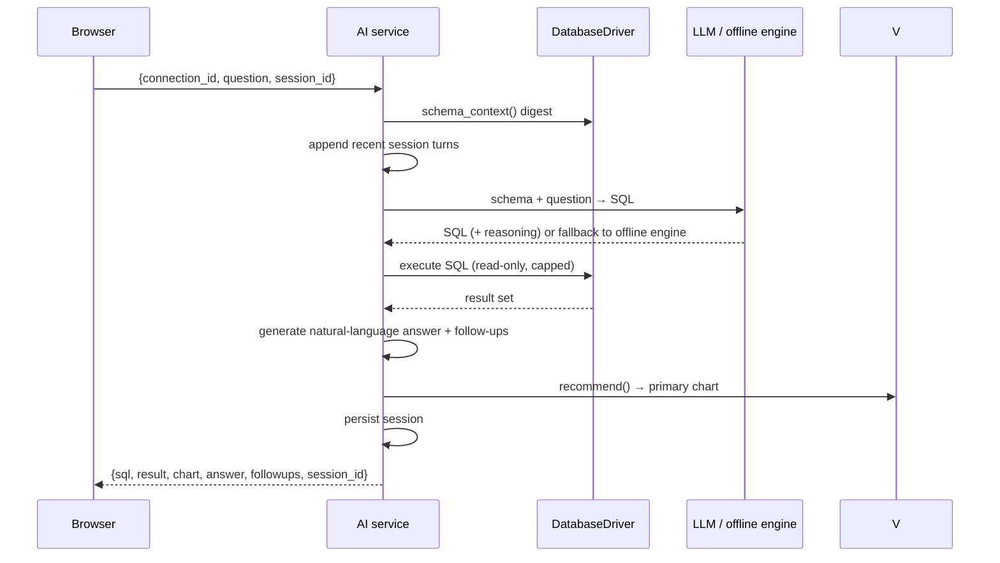

# LumenDB Architecture

LumenDB is a **single-process B/S application**: one `uvicorn` worker hosts the REST API, the MCP Streamable HTTP server and (after `pnpm build`) the SPA. This document explains how the pieces fit together and where to extend them.

## Design goals

1. **Zero-config trial** — a seeded demo database plus an offline NL2SQL engine; no API key, no external service.
2. **One port** — UI, `/api/*` and `/mcp` share port 8000, which also makes tunneling trivial.
3. **Safety by default** — SQL classification, explicit write confirmation, hard read-only MCP, row caps, optional token auth.
4. **Swappable parts** — drivers, LLM provider and chart types are isolated behind small interfaces.

## Layers



## Module map

| Layer | Files | Responsibility |
| --- | --- | --- |
| Config | `app/config.py` | Pydantic settings (`LUMEN_*`), derived paths, LLM/feature flags, Fernet key from `LUMEN_SECRET` |
| Metadata | `app/store.py` | SQLite tables: `connections`, `query_history`, `saved_queries`, `dashboards`, `ai_sessions`, `settings`; encrypts passwords; CRUD + history pruning |
| Drivers | `app/db/engine.py` | `EngineCache`, `DatabaseDriver`: URL building, `test()`, databases/schemas/tables/views, `describe_table()` (columns, PK/FK, indexes, pseudo-DDL, samples), `erd()`, `schema_context()`, `execute()`, `explain()`, `preview()` |
| SQL safety | `app/db/engine.py` | `strip_sql_comments`, `split_sql`, `classify_sql`, read-only enforcement, row caps, statement timeouts |
| Offline AI | `app/services/nl2sql.py` | Intent parsing, schema scoring, FK-graph JOIN resolution, time / Top-N / grouping templates, question suggestions |
| LLM adapter | `app/services/llm.py` | OpenAI-compatible `/chat/completions` with timeout, temperature and automatic fallback |
| Visualization | `app/services/viz.py` | `recommend()` inspects column types and cardinalities, returns ranked chart specs |
| AI orchestration | `app/services/ai.py` | Ask-data pipeline, multi-turn sessions, SQL explain/fix, natural-language answer |
| REST | `app/routers/*.py` | Typed Pydantic request/response models, all `/api/*` routes |
| MCP | `app/mcp_server.py` | Tool/resource registration, JSON/TOON/CSV formatting, error shielding |
| Assembly | `app/main.py` | Lifespan bootstrap, token middleware, MCP mount, SPA fallback, ASGI path wrapper |
| Frontend | `frontend/src/` | Components, typed REST client, Zustand store, i18n, theme, design tokens |

## Boot sequence

```
uvicorn app.main:app
  → lifespan(app)
     → bootstrap_storage()
        → build_demo_db()  (idempotent; 5 tables + 1 view, ~1.5k rows)
        → seed demo connection (with business-label semantics)
        → seed sample dashboard (5 live SQL cards)
     → mcp_app.lifespan(app)  (fastmcp session manager)
  → serve requests
```

Everything is idempotent: restarting never duplicates demo data.

## Request flows

### SQL execution



### AI Query (AI 问数)



## Offline NL2SQL engine

The built-in engine is deterministic and schema-driven:

1. Build a compact digest from `schema_context()` — tables, labelled columns, types, primary/foreign keys, date columns, sample values.
2. Parse the question into an intent: metric (sum/count/avg), dimension, grouping words, time phrase (`按月`, `最近 3 个月`), Top-N (`前 5`), filters (channel / status / city), and detail-vs-aggregate mode.
3. Score candidate tables/columns against the question (exact term matches + Chinese bigram fallback), pick the main table, and resolve the JOIN path through the foreign-key graph.
4. Emit dialect-aware SQL with quoting, aliases, `GROUP BY`, `ORDER BY` and `LIMIT`; execute it read-only.

Configuring `LUMEN_LLM_BASE_URL` (or `LUMEN_LLM_API_KEY`) switches step 3–4 to an LLM-generated SQL, with automatic fallback to the offline engine on failure. Supported providers: any OpenAI-compatible `/chat/completions` endpoint (OpenAI, DeepSeek, Ollama, vLLM).

## Visualization

`services/viz.recommend()` examines the result shape — one categorical dimension + numeric measures → bar (ranked), time-like dimension → line/area, low-cardinality composition → pie, single scalar → metric, otherwise table. Specs carry `x`, `y`, `series`, `title` and a human-readable `reason`. The front-end renders them with ECharts in **SVG mode** and lets users switch between ranked alternatives; dashboard cards persist the chosen spec plus their live SQL.

## Safety model

| Guard | Behaviour |
| --- | --- |
| SQL classification | `classify_sql()` distinguishes read, write, DDL and unknown statements; comments are stripped first |
| REST writes | Require `LUMEN_ALLOW_WRITE=true` **and** `confirm_write=true`; otherwise `403` |
| MCP | `enforce_readonly=True` on every tool path — writes/DDL/multi-statement are refused regardless of config |
| Limits | `LUMEN_MAX_ROWS` (1000), `LUMEN_MCP_MAX_ROWS` (100), `LUMEN_QUERY_TIMEOUT` (30s) |
| Auth | Optional `LUMEN_API_TOKEN` middleware covers `/api/*` and `/mcp`; `/api/health` and `OPTIONS` are exempt |
| Secrets | Connection passwords encrypted with a Fernet key derived from `LUMEN_SECRET`, never returned by API/MCP |

## MCP on the same port

`fastmcp.http_app(path="/")` is mounted at `settings.mcp_path` (`/mcp`) and its lifespan is nested inside the FastAPI lifespan. Starlette's `Mount` strips the prefix, so the child app sees an empty path and its `/` route answers `307` to `/mcp/` — most MCP clients do **not** follow redirects on `POST`. `NormalizeMcpPath` is a thin ASGI wrapper that rewrites only the internal `scope["path"]` from `/mcp` to `/mcp/` before routing, keeping the public endpoint exactly `/mcp` while preserving all fastmcp middleware and session handling.

## Frontend architecture

- `lib/api.ts` — typed fetch client for every REST endpoint, with a shared error helper and optional token header.
- `lib/store.ts` — Zustand store: active connection, view, cached schema, toasts, token.
- `lib/theme.tsx` — system / light / dark, resolved from `prefers-color-scheme`, persisted.
- `i18n/index.tsx` — `en` default / `zh`, `?lang=` override, `localStorage` persistence.
- `components/` — one component per view; `ui.tsx` holds shared primitives; `AnimatedBackground.tsx` draws the animated SVG backdrop.
- Build splits vendors into `react` / `charts` / `editor` / `markdown` chunks; no emoji anywhere, inline SVG icons only.

## Deployment topologies

| Mode | Command | Ports |
| --- | --- | --- |
| Development | `bash scripts/dev.sh` | Vite 5173 (proxies `/api`, `/mcp`) + uvicorn 8000 |
| Single-port | `bash scripts/start.sh` | 8000 only (serves `frontend/dist`) |
| Public | single-port + cloudflared named tunnel / ingress | HTTPS domain → 8000 |

## Extension points

- **New dialect** — add a branch in `build_url()` / `EngineCache._create()` plus dialect-specific introspection in `DatabaseDriver`.
- **New MCP tool** — decorate a function with `@mcp.tool` in `mcp_server.py`; reuse `_safe()` and `format_payload()` for consistent errors/output.
- **New chart type** — extend `viz.recommend()` and the `ChartView` renderer plus `CHART_TYPES` in `DashboardView`.
- **New language** — add a dictionary in `i18n/index.tsx` and extend the `Lang` union.
- **Richer AI** — swap `services/llm.py` or add retrieval over schema/query history; the orchestration contract stays the same.

## Known limitations

- The demo is SQLite; PostgreSQL/MySQL are supported but require reachable servers (drivers are bundled).
- The result grid renders capped result sets (1000 rows) rather than virtualizing millions of rows.
- Offline NL2SQL is rule-based: it excels at schema-shaped analytical questions, not arbitrary semantics; configure an LLM for open-ended ones.
- Single-process design: no multi-tenancy, RBAC or horizontal scaling (fine for a self-hosted workbench).

See also: [MCP.md](MCP.md) · [中文](ARCHITECTURE.zh-CN.md) · [root README](../README.md)
