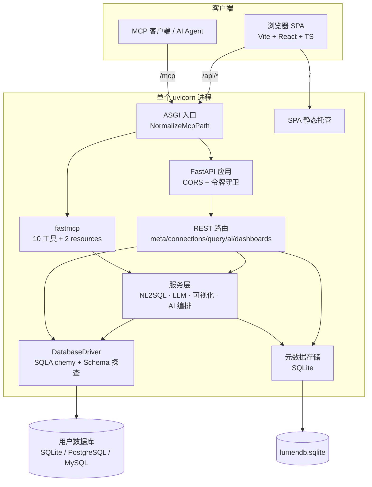
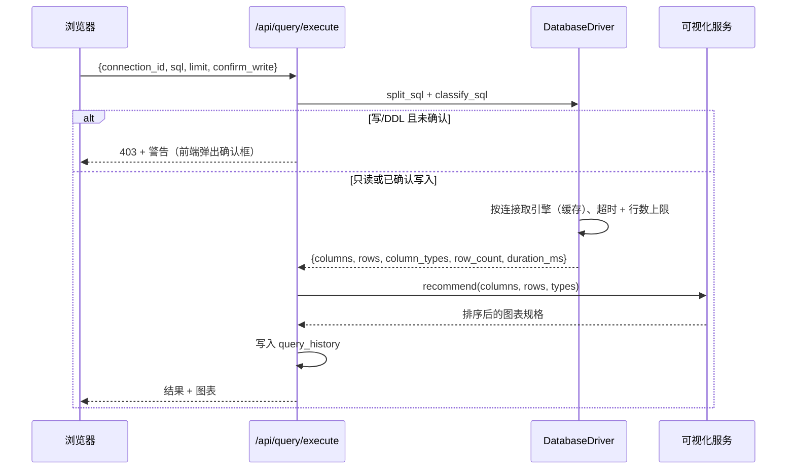
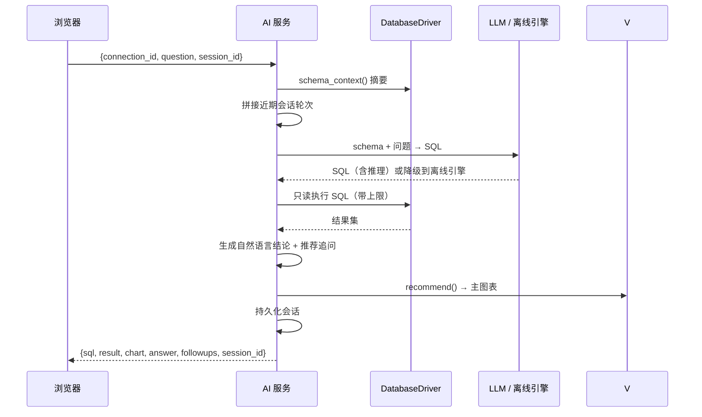

# LumenDB 架构说明

LumenDB 是**单进程 B/S 应用**：一个 `uvicorn` 工作进程同时托管 REST API、MCP Streamable HTTP 服务，以及（执行 `pnpm build` 后的）SPA。本文说明各模块如何协作，以及扩展点在哪里。

## 设计目标

1. **零配置试用** —— 内置演示库 + 离线 NL2SQL 引擎，无需 API Key 或外部服务。
2. **单端口** —— UI、`/api/*` 与 `/mcp` 共用 8000 端口，内网穿透只需转发一个端口。
3. **默认安全** —— SQL 分类、写操作显式确认、MCP 硬只读、行数上限、可选令牌鉴权。
4. **部件可替换** —— 驱动、LLM 提供方与图表类型都隔离在小接口之后。

## 分层



## 模块清单

| 层次 | 文件 | 职责 |
| --- | --- | --- |
| 配置 | `app/config.py` | Pydantic 设置（`LUMEN_*`）、派生路径、LLM/功能开关、由 `LUMEN_SECRET` 派生 Fernet 密钥 |
| 元数据 | `app/store.py` | SQLite 表：`connections`、`query_history`、`saved_queries`、`dashboards`、`ai_sessions`、`settings`；密码加密；CRUD 与历史清理 |
| 驱动 | `app/db/engine.py` | `EngineCache`、`DatabaseDriver`：URL 构建、`test()`、数据库/Schema/表/视图、`describe_table()`（列、主外键、索引、伪 DDL、样例）、`erd()`、`schema_context()`、`execute()`、`explain()`、`preview()` |
| SQL 安全 | `app/db/engine.py` | `strip_sql_comments`、`split_sql`、`classify_sql`、只读约束、行数上限、语句超时 |
| 离线 AI | `app/services/nl2sql.py` | 意图解析、Schema 打分、外键图谱 JOIN 解析、时间 / Top-N / 分组模板、推荐问题 |
| LLM 适配 | `app/services/llm.py` | OpenAI 兼容 `/chat/completions`，含超时、temperature 与自动降级 |
| 可视化 | `app/services/viz.py` | `recommend()` 检查列类型与基数，返回排序后的图表规格 |
| AI 编排 | `app/services/ai.py` | 问数流水线、多轮会话、SQL 解释/修复、自然语言结论 |
| REST | `app/routers/*.py` | 类型化 Pydantic 请求/响应模型，全部 `/api/*` 路由 |
| MCP | `app/mcp_server.py` | 工具/resource 注册、JSON/TOON/CSV 格式化、异常屏蔽 |
| 装配 | `app/main.py` | lifespan 引导、令牌中间件、MCP 挂载、SPA fallback、ASGI 路径包装 |
| 前端 | `frontend/src/` | 组件、类型化 REST 客户端、Zustand 状态、i18n、主题、设计令牌 |

## 启动流程

```
uvicorn app.main:app
  → lifespan(app)
     → bootstrap_storage()
        → build_demo_db()  （幂等；5 张表 + 1 个视图，约 1.5k 行）
        → 播种演示连接（带业务标签语义）
        → 播种示例看板（5 张实时 SQL 卡片）
     → mcp_app.lifespan(app)  （fastmcp 会话管理）
  → 开始服务请求
```

全部幂等：重启不会重复写入演示数据。

## 请求链路

### SQL 执行



### AI 问数



## 离线 NL2SQL 引擎

内置引擎是确定性、由 Schema 驱动的：

1. 由 `schema_context()` 生成紧凑摘要 —— 表、带业务标签的列、类型、主外键、日期列、样例值。
2. 把问题解析为意图：指标（求和/计数/平均）、维度、分组词、时间短语（`按月`、`最近 3 个月`）、Top-N（`前 5`）、过滤条件（渠道 / 状态 / 城市），以及明细模式与聚合模式。
3. 对候选表/列打分（精确词匹配 + 中文 2-gram 兜底），选定主表，并沿外键图谱解析 JOIN 路径。
4. 生成方言适配 SQL（标识符引用、别名、`GROUP BY`、`ORDER BY`、`LIMIT`），只读执行。

配置 `LUMEN_LLM_BASE_URL`（或 `LUMEN_LLM_API_KEY`）后，第 3–4 步切换为 LLM 生成 SQL，失败时自动降级回离线引擎。支持任意 OpenAI 兼容 `/chat/completions` 端点（OpenAI、DeepSeek、Ollama、vLLM）。

## 可视化

`services/viz.recommend()` 检查结果形状 —— 一个分类维度 + 数值指标 → 柱状（排序后）；时间型维度 → 折线/面积；低基数构成 → 饼图；单个标量 → 指标卡；其余 → 表格。规格包含 `x`、`y`、`series`、`title` 与可读的 `reason`。前端用 ECharts 的 **SVG 模式**渲染，并可在多个推荐之间切换；看板卡片持久化所选规格与其对应的实时 SQL。

## 安全模型

| 防线 | 行为 |
| --- | --- |
| SQL 分类 | `classify_sql()` 区分只读、写入、DDL 与未知语句；先剥离注释 |
| REST 写操作 | 需同时满足 `LUMEN_ALLOW_WRITE=true` 与 `confirm_write=true`，否则 `403` |
| MCP | 所有工具路径强制 `enforce_readonly=True` —— 写入/DDL/多语句一律拒绝，不受配置影响 |
| 限额 | `LUMEN_MAX_ROWS`（1000）、`LUMEN_MCP_MAX_ROWS`（100）、`LUMEN_QUERY_TIMEOUT`（30 秒） |
| 鉴权 | 可选 `LUMEN_API_TOKEN` 中间件覆盖 `/api/*` 与 `/mcp`；`/api/health` 与 `OPTIONS` 豁免 |
| 机密 | 连接密码用 `LUMEN_SECRET` 派生的 Fernet 密钥加密，API/MCP 均不返回 |

## 同端口挂载 MCP

`fastmcp.http_app(path="/")` 挂载在 `settings.mcp_path`（`/mcp`），其 lifespan 嵌套在 FastAPI lifespan 内。Starlette 的 `Mount` 会剥离前缀，子应用看到空路径，其 `/` 路由便对 `/mcp/` 返回 `307` —— 而大多数 MCP 客户端在 `POST` 上**不会**跟随重定向。`NormalizeMcpPath` 是一层很薄的 ASGI 包装：只在内部把 `scope["path"]` 从 `/mcp` 改写为 `/mcp/`，对外端点仍严格是 `/mcp`，同时完整保留 fastmcp 的中间件与会话管理。

## 前端架构

- `lib/api.ts` —— 覆盖全部 REST 端点的类型化 fetch 客户端，共享错误解析与可选令牌头。
- `lib/store.ts` —— Zustand 状态：当前连接、视图、缓存 Schema、toast、令牌。
- `lib/theme.tsx` —— 跟随系统 / 浅色 / 深色，读取 `prefers-color-scheme`，选择持久化。
- `i18n/index.tsx` —— 默认 `en` / 可切 `zh`，`?lang=` 覆盖，`localStorage` 持久化。
- `components/` —— 每个视图一个组件；`ui.tsx` 提供共享原子组件；`AnimatedBackground.tsx` 绘制动态 SVG 背景。
- 构建按 `react` / `charts` / `editor` / `markdown` 分包；全站不使用 emoji，图标一律内联 SVG。

## 部署形态

| 模式 | 命令 | 端口 |
| --- | --- | --- |
| 开发 | `bash scripts/dev.sh` | Vite 5173（代理 `/api`、`/mcp`）+ uvicorn 8000 |
| 单端口 | `bash scripts/start.sh` | 仅 8000（托管 `frontend/dist`） |
| 公网 | 单端口 + cloudflared 命名隧道 / ingress | HTTPS 域名 → 8000 |

## 扩展点

- **新增方言** —— 在 `build_url()` / `EngineCache._create()` 增加分支，并补齐 `DatabaseDriver` 的方言专属探查逻辑。
- **新增 MCP 工具** —— 在 `mcp_server.py` 用 `@mcp.tool` 装饰函数，复用 `_safe()` 与 `format_payload()` 保持错误与输出格式一致。
- **新增图表类型** —— 扩展 `viz.recommend()`、`ChartView` 渲染分支，以及 `DashboardView` 的 `CHART_TYPES`。
- **新增语言** —— 在 `i18n/index.tsx` 增加词典并扩展 `Lang` 联合类型。
- **更强的 AI** —— 替换 `services/llm.py`，或基于 Schema/查询历史加入检索；编排层契约不变。

## 已知限制

- 演示库为 SQLite；PostgreSQL / MySQL 已支持但需可连接的实例（驱动已随包安装）。
- 结果网格渲染的是有上限的结果集（1000 行），并未对百万行做虚拟滚动。
- 离线 NL2SQL 是规则引擎：擅长贴合 Schema 的分析型问题，不擅长任意语义；开放问题建议配置 LLM。
- 单进程设计：无多租户、RBAC 或水平扩展能力（自托管工作台场景足够）。

相关文档：[MCP.zh-CN.md](MCP.zh-CN.md) · [English](ARCHITECTURE.md) · [根目录 README](../README.zh-CN.md)
