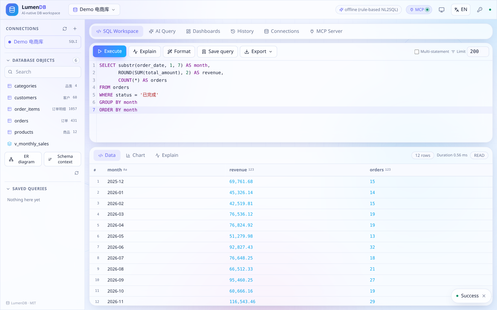
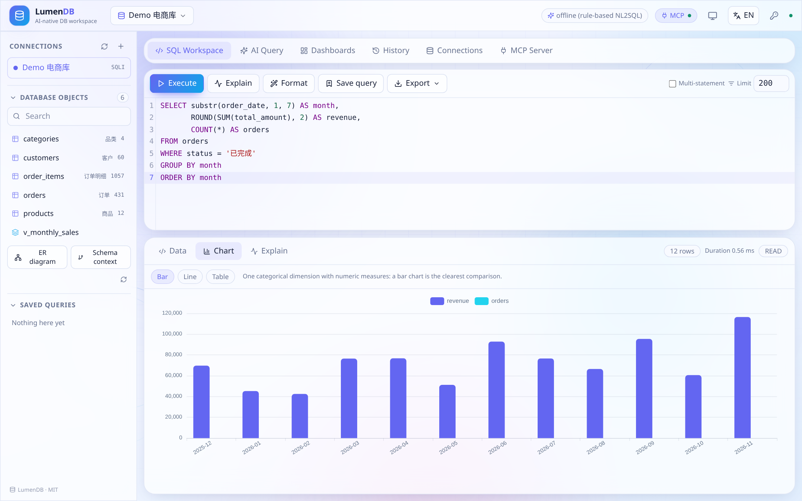
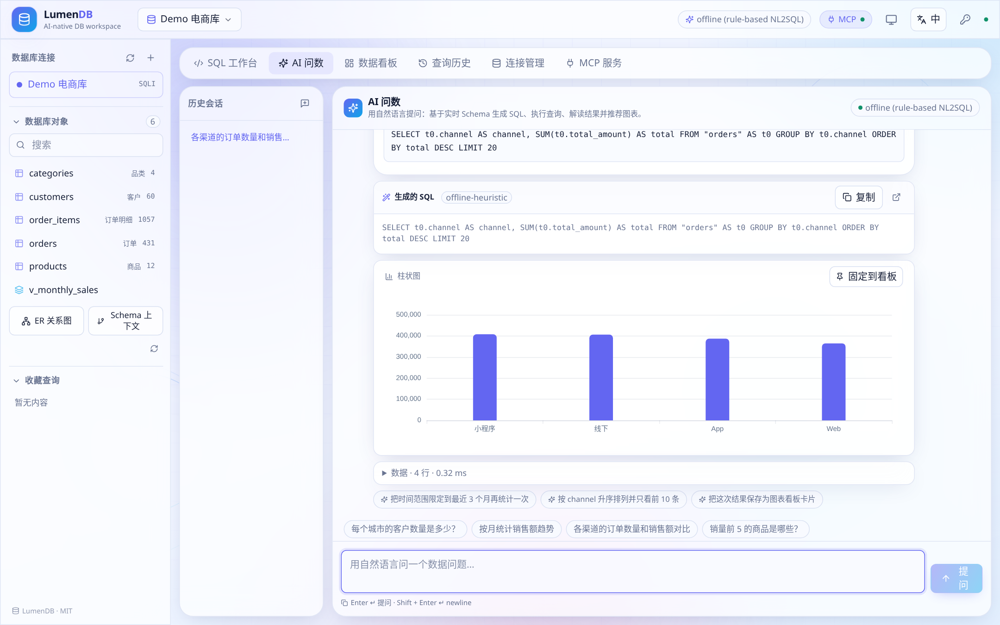
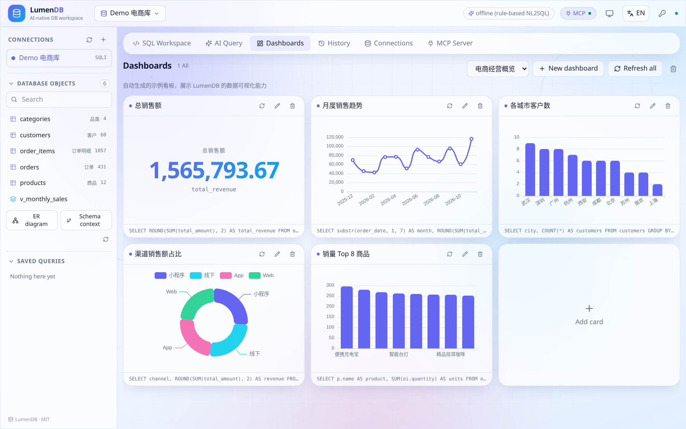

# LumenDB Frontend

Vite + React + TypeScript SPA for [LumenDB](../README.md) — an AI-native database workspace.

## Stack

| Concern | Choice |
| --- | --- |
| Build | Vite 6, TypeScript 5 (strict) |
| UI | React 18, Tailwind CSS 3 with CSS-variable design tokens |
| State | Zustand |
| Motion | framer-motion (panel/message transitions), animated SVG background |
| SQL editor | CodeMirror 6 (`@uiw/react-codemirror` + `@codemirror/lang-sql`) with schema-aware completion |
| Charts | Apache ECharts 5 (SVG renderer), auto-recommended from the result shape |
| Icons | lucide-react inline SVG — **no emoji** anywhere |
| i18n | Built-in dictionary, `en` by default / `zh`, `?lang=zh` or top-bar toggle |
| Theme | system / light / dark, follows `prefers-color-scheme` by default |

## Commands

```bash
pnpm install
pnpm dev        # http://localhost:5173, proxies /api and /mcp to :8000
pnpm typecheck  # tsc --noEmit
pnpm build      # typecheck + production bundle to dist/
pnpm preview
```

`pnpm build` splits vendors into `react` / `charts` / `editor` / `markdown` chunks so the app shell stays small. After building, the backend serves `dist/` on the same origin — no separate web server is needed.

## Structure

| Path | Contents |
| --- | --- |
| `src/components/` | `TopBar`, `Sidebar`, `Workspace`, `SqlEditor`, `ResultGrid`, `ChartView`, `AiChat`, `DashboardView`, `HistoryView`, `ConnectionsView`, `McpView`, `ui.tsx`, `AnimatedBackground.tsx` |
| `src/lib/` | `api.ts` (typed REST client), `store.ts` (Zustand app state), `theme.tsx` |
| `src/i18n/index.tsx` | `useI18n()` hook and the `en` / `zh` dictionaries |
| `src/styles/index.css` | Tailwind layers, design tokens, light/dark theme variables |
| `src/App.tsx` | View routing and the responsive layout shell |

## Design rules

- **Mobile-first**: the sidebar becomes a drawer, editor/result panels stack, toolbars wrap and hide secondary labels.
- Light animated gradient background with floating SVG shapes; dark theme is equally supported.
- No emoji — all iconography is inline SVG.
- Theme and language choices persist in `localStorage`; `?lang=` overrides them for sharing and screenshots.

## Screenshots









More: [../docs/screenshots](../docs/screenshots) · Chinese: [README.zh-CN.md](./README.zh-CN.md) · Root: [README.md](../README.md)
