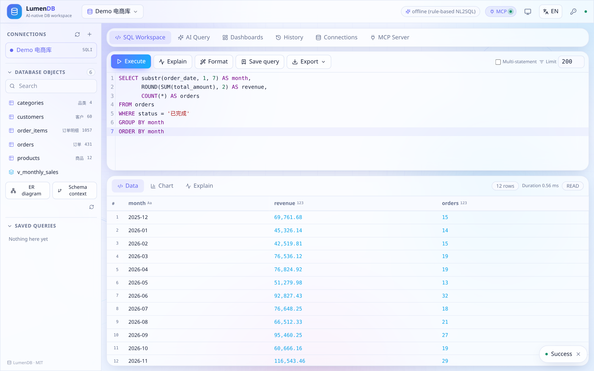
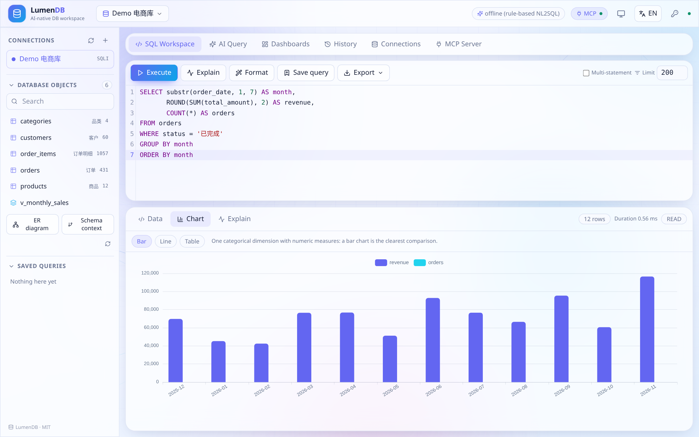
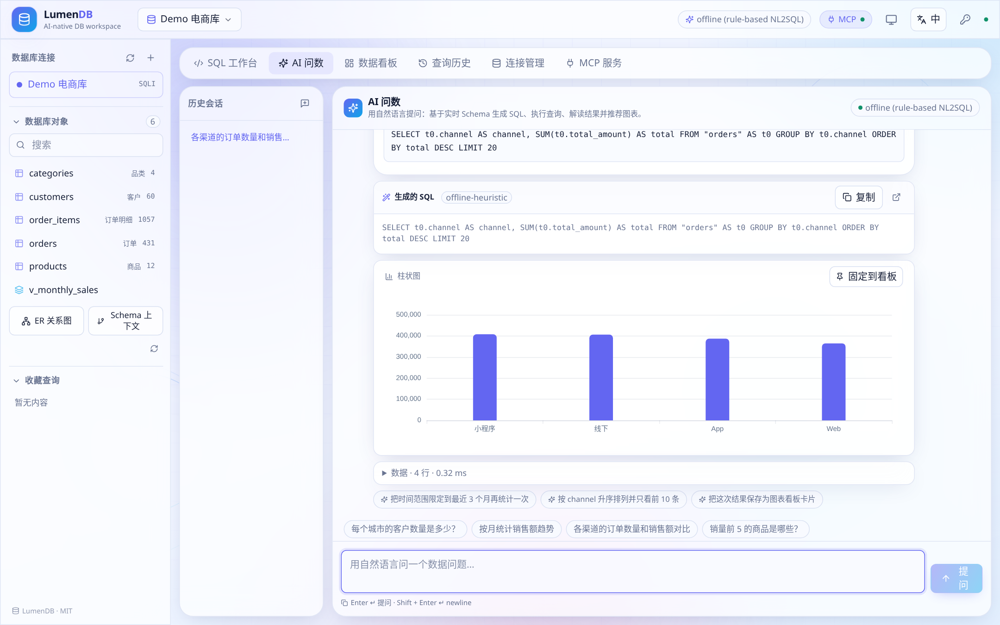
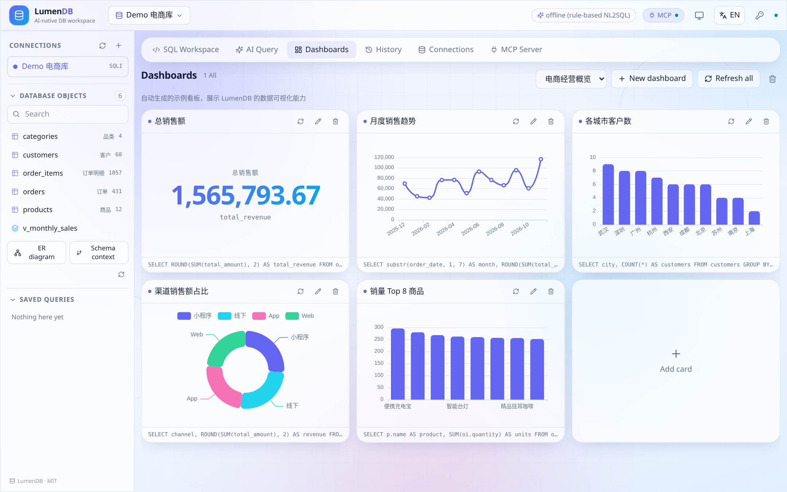

# LumenDB 前端

[LumenDB](../README.zh-CN.md) 的单页应用，基于 Vite + React + TypeScript，AI 原生数据库工作台的交互层。

## 技术栈

| 关注点 | 选型 |
| --- | --- |
| 构建 | Vite 6、TypeScript 5（strict） |
| UI | React 18、Tailwind CSS 3（CSS 变量设计令牌） |
| 状态 | Zustand |
| 动效 | framer-motion（面板/消息过渡）、动态 SVG 背景 |
| SQL 编辑器 | CodeMirror 6（`@uiw/react-codemirror` + `@codemirror/lang-sql`），支持 Schema 感知补全 |
| 图表 | Apache ECharts 5（SVG 渲染器），根据结果形状自动推荐 |
| 图标 | lucide-react 内联 SVG —— **全站不使用 emoji** |
| 国际化 | 内置词典，默认 `en` / 可切 `zh`，支持 `?lang=zh` 或顶部栏切换 |
| 主题 | 跟随系统 / 浅色 / 深色，默认读取 `prefers-color-scheme` |

## 常用命令

```bash
pnpm install
pnpm dev        # http://localhost:5173，/api 与 /mcp 代理到 :8000
pnpm typecheck  # tsc --noEmit
pnpm build      # 类型检查 + 产物输出到 dist/
pnpm preview
```

`pnpm build` 会把依赖拆成 `react` / `charts` / `editor` / `markdown` 分包，主包保持轻量。构建后由后端同源托管 `dist/`，无需单独部署 Web 服务器。

## 目录结构

| 路径 | 内容 |
| --- | --- |
| `src/components/` | `TopBar`、`Sidebar`、`Workspace`、`SqlEditor`、`ResultGrid`、`ChartView`、`AiChat`、`DashboardView`、`HistoryView`、`ConnectionsView`、`McpView`、`ui.tsx`、`AnimatedBackground.tsx` |
| `src/lib/` | `api.ts`（类型化 REST 客户端）、`store.ts`（Zustand 状态）、`theme.tsx` |
| `src/i18n/index.tsx` | `useI18n()` 与 `en` / `zh` 词典 |
| `src/styles/index.css` | Tailwind 层、设计令牌、浅/深主题变量 |
| `src/App.tsx` | 视图路由与响应式布局外壳 |

## 设计约定

- **移动优先**：侧栏折叠为抽屉，编辑器与结果面板纵向堆叠，工具栏自动换行并隐藏次要标签。
- 浅色动态渐变背景 + 浮动 SVG 图形；深色主题同样完整适配。
- 不使用 emoji，所有图标均为内联 SVG。
- 主题与语言选择持久化在 `localStorage`，`?lang=` 可覆盖，便于分享与截图。

## 截图









更多截图见 [../docs/screenshots](../docs/screenshots) · 英文文档：[README.md](./README.md) · 根目录：[README.zh-CN.md](../README.zh-CN.md)
